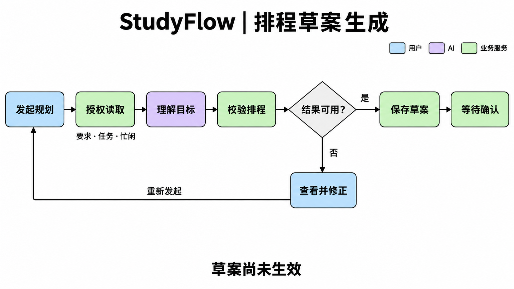
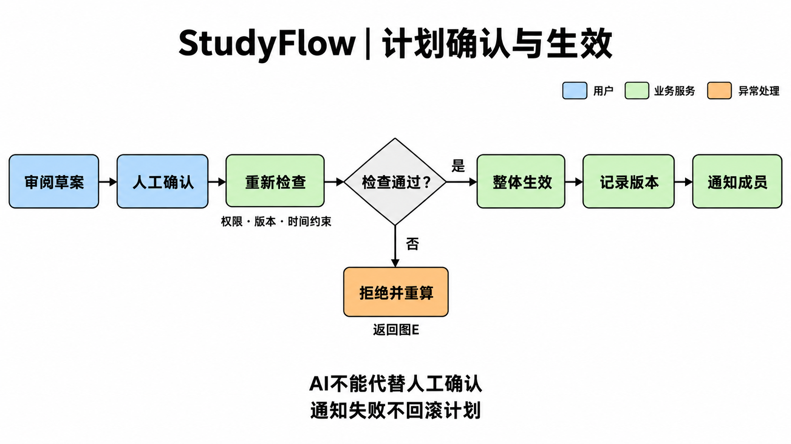

# 课办 StudyFlow：AI、排程与人机交接需求

第24组｜李一芃 2454326｜2026年10月21日｜版本 1.1

本稿对应第二次提交的李一芃分工，可合入总 SRS 的用例与业务流程、非功能需求章节。配套文件提供创新量化验证、参考资料、三人 AI 反思汇总及附件索引。本文定义需求与拟定验收条件，不代表产品已经实现或实验已经完成。

## 1. 范围、依据与分析决定

### 1.1 与现有交付的衔接

沿用 A-F01～A-F08、UC-01～UC-12、UI-01～UI-04，以及雍致鸣交付中的 BR-01～BR-12、NFR-A01～NFR-A07。本稿补充 UC-06、UC-09，并向 UC-07 提供 AI 行为说明；正式计划应用继续由 UC-08 定义，不另设一套确认权限或版本规则。

P0 从学生主动粘贴的文本、已确认要求、正式任务及成员可用时段出发。PDF 导入、日历导出、历史工时辅助估计及教师/助教视图均保留为 P1。可用时间变更检测、影响标记及提醒可以自动执行，正式调整草案须由当前作业管理者发起；个人作业管理者是所有者，小组作业管理者是当前负责人。

依据：课程作业 PDF 第3页、第一次报告第4、6～8、13～14页、根目录分工文件，以及两位组员已交正文。参考文献统一见[参考资料与来源核对](参考资料与来源核对.md)；本文采用的用例结构参考 R01，人机交接参考 R04，受限工具调用流程参考 R05。这些文献提供方法依据，项目阈值来自团队材料及本次分析，不是文献证明的产品效果。

### 1.2 职责分离

| 主体 | 应承担的职责 | 不具有的权限 |
|---|---|---|
| 用户/作业管理者 | 核对原文、补全缺项、编辑正式输入、审阅差异、确认计划 | 普通成员不能确认小组计划，不能修改他人私人时段 |
| 内部 AI 代理及外部模型 | 理解问题，提出工具调用请求，将结构化结果解释为建议 | 不决定授权，不直接保存正式任务或时间块，不代替用户确认 |
| 确定性业务服务 | 校验身份和字段、读取授权数据、验证依赖、模拟排程、校验结果、保存草案 | 不把软偏好改成硬约束，不凭模型判断宣告计划合法 |
| 人工确认入口（UC-08） | 重新检查权限、输入版本及最新占用，整体应用计划，记录确认与通知事件 | 不接受模型代发的确认，不让已失效草案覆盖新输入 |

### 1.3 本次为闭合规格提出的细化

下列内容为待三人评审的分析决定；其余要求沿用共同基线。

1. P0 以任务的正数预计工时作为本次待安排工作量。已完成任务不重新分配时间；进行中、待验收任务及其既有时间块默认固定。确需重新安排时先经权限允许的状态/任务编辑，明确剩余工时和范围，再运行 UC-09；不猜测已经投入的工时。
2. 一项待排程任务默认使用一个连续时间块，不由 AI 静默拆分。需要分段时由管理者在 UC-04 拆成任务并设置依赖。这是控制首版复杂度的建议，团队若改为可中断任务，应同步修改本文及排程案例。
3. 模拟调整时，当前作业中被本次替换的旧时间块可在模拟副本内被新安排替代；其他作业占用、当前作业固定任务仍是硬约束。正式确认前实际占用保持不变，不能提前释放。
4. 没有官方截止日期时允许管理者明确填写“用户设定的规划上限”，并与原文要求分开标识；连规划上限也缺失时，只保存信息草稿，不生成可确认排程。
5. 运行状态与业务结论分开记录：运行可为完成、失败、超时、取消；排程结论可为可行、有证据不可行、未找到方案。超时或工具失败不能被包装成不可行。

## 2. UC-06：生成排程草案并解释冲突

### 2.1 基本信息

| 项目 | 规格 |
|---|---|
| 目标与关联需求 | 依据已确认要求和授权时间数据生成可审阅草案，或给出可操作的冲突解释；A-F04、A-F05 |
| 主要参与者 | 当前小组负责人；个人场景为作业所有者 |
| 辅助参与者 | 普通成员提供本人可用时间/本人任务工时；外部模型服务辅助理解与解释，排程服务是内部组件 |
| 触发条件 | 管理者在 UI-03 选择“生成排程草案” |
| 前置条件 | 已登录且有当前作业管理权；已有已确认要求和通过 UC-04 保存的任务；用户授权本次 AI 数据处理，或选择手工路径 |
| 输入准备 | 负责人有效、工时为正、依赖合法；存在明确时区及适用截止日期/用户规划上限；缺项按异常流程补齐 |
| 成功后置条件 | 保存带输入版本、模拟结果、来源及原因摘要的待确认草案，转交 UC-08；正式计划与占用不变 |
| 失败最低保证 | 不改正式任务、工时、截止日期和时间块；保留授权范围内的输入及诊断，手工操作可继续 |
| 关联规则与界面 | BR-01～BR-07、BR-10、BR-12；UI-03，缺项返回 UI-01/UI-02 或本人时间入口 |
| 验收关联 | V-06A～V-06J；NFR-A01～NFR-A07、NFR-P02、NFR-R03 |

### 2.2 基本成功流程

1. 管理者选择目标作业，检查任务范围，发起生成请求，可填写均衡负担、减少切换等软偏好。
2. 系统检查当前权限、数据处理选择及本次预算，建立运行标识和输入快照；展示运行状态及取消入口。
3. 系统读取已确认要求、正式任务、依赖、成员可用窗口和必要占用；验证各对象属于授权范围，记录输入版本。其他空间占用只作为匿名忙闲区间参与规划。
4. 模型在允许的数据范围内解释用户目标并提出白名单工具调用；业务服务再次检查调用权限、字段、数值、对象归属及调用额度。作业原文中的命令只作为文本数据处理。
5. 确定性服务检查依赖无环、成员有效、工时与时间边界完整，调用 `simulate_schedule`；先满足可用窗口、不重叠、依赖及截止条件，再尝试优化软偏好。
6. 系统对模拟结果独立校验：待排程任务恰好各安排一次、工时足额、无重复或虚构任务、固定时间块未被擅改，并复查全部硬约束。
7. 模型根据校验后的结构化结果生成原因摘要；系统核对解释中的任务、时间及冲突与工具结果一致。模型不得自行增加“老师要求”或宣称全局最优。
8. 系统再次检查权限和快照新鲜度，通过 `create_plan_proposal` 保存待确认草案，绑定本节2.4所列版本。保存失败或输入已变更时不展示可确认状态。
9. 系统在 UI-03 显示安排、来源、软偏好取舍、适用规划边界、依据版本和“尚未生效”。首次计划注明“首次建立”，已有计划展示差异。
10. 管理者审阅后进入 UC-08 确认，也可取消、修改输入后重算。生成成功本身不表示计划已经生效。

### 2.3 备选与异常流程

| 编号；对应步骤 | 条件 | 系统响应及恢复 |
|---|---|---|
| 2a；步骤2/8 | 普通成员发起正式草案、角色被撤销或跨空间请求 | 拒绝操作；不返回被拒绝资源内容。普通成员可走 UC-07 查看授权建议，由管理者发起正式规划 |
| 2b；步骤2 | 用户未授权外发或选择关闭 AI | 不发送模型请求；转手工编辑/确定性服务可用的规划入口，仍须通过 UC-08 确认 |
| 3a；步骤3/5 | 工时、有效负责人、可用窗口或规划边界缺失 | 列出具体字段及补全入口；没有填写时段与明确填写无可用时间分别显示；不得以猜测值生成可确认草案 |
| 4a；步骤4 | 非白名单工具、非法参数、跨空间 ID、夹带指令 | 服务端拒绝；记录脱敏错误。可修正的格式错误最多重试一次，授权违规不通过重试扩大权限 |
| 5a；步骤5 | 任务图有环或同作业依赖引用无效 | 返回环路/失效引用，转 UC-04；不部分保存修复，不把无效输入计作不可行排程 |
| 5b；步骤5 | 有容量下界或其他确定性证据证明不可行 | 显示冲突任务、受限区间、需求与可用容量、证明范围；提供调整入口，不保存可确认草案 |
| 5c；步骤5 | 启发式在搜索限制内未找到方案，但无不可行证明 | 显示“未找到满足约束的方案”；允许手工修改或重新尝试，不断言无解 |
| 5d；步骤3～8 | 工具失败、网络断开或临时服务错误 | 同一失败动作至多重试一次，且受总预算与时限约束；停止后保留诊断和手工入口，不伪造成功 |
| 6a；步骤6 | 返回结果违反约束、工时不足或包含重复/未知任务 | 拒绝保存为待确认草案，保留校验错误；有限重试仍不合法则结束 |
| 7a；步骤7 | 解释编造任务/来源，或模型解释阶段不可用 | 丢弃不可靠解释。若已得到有效模拟结果且总时限尚未到，可用服务模板解释；否则终止并保留手工路径 |
| 8a；步骤8 | 运行中任务、时间或当前计划发生规划相关修改 | 将当前结果标为过期，不应用；提示修改类别，使用新输入重新生成 |
| 8b；步骤8 | 草案保存响应丢失 | 按相同运行及保存请求标识查询/重试，返回同一草案，不产生重复草案 |
| 9a；任意阶段 | 60秒总时限到达、用户取消或额度耗尽 | 转明确终态，阻止后到输出继续保存新的待确认草案；已经保存的草案仅允许重新查询并显示状态，不自动应用 |
| 10a；步骤10 | 用户修改展示中的安排或硬约束 | 作为新的输入/草案修订重新校验；不把旧校验结果用于修改后的内容 |

### 2.4 草案的最小可追溯内容

草案必须包含：草案/运行标识、空间与作业标识、创建人和时间、依据的作业说明/要求集合/任务集/依赖版本、参与成员可用时间版本、当前计划版本（首次为空）、读取占用时的版本或快照标识、规划边界及其来源、候选时间块、校验结论、差异与解释摘要。

只有规划相关输入变化才使草案失效，例如负责人、工时、依赖、要求/截止、可用窗口、任务执行状态、当前计划及有关占用；普通评论等无关元数据不应触发重排。占用快照只说明生成时检查过，不能代替 UC-08 对最新占用的复查。

### 2.5 拟定验收场景

| 编号 | Given / When | Then |
|---|---|---|
| V-06A 正常草案 | 有合法任务与充足窗口，管理者生成 | 返回可追溯草案；每项任务足额安排且硬约束违反数为0；正式版本/占用不增加 |
| V-06B 缺失输入 | 缺日期且无用户规划上限，或工时为空 | 精确提示缺项，不产生可确认草案，不补造官方日期 |
| V-06C 证明不可行 | 某成员截止前仅有2小时可用，必须完成3小时任务 | 显示该成员容量不足1小时；不给出越界安排 |
| V-06D 搜索未找到 | 注入搜索预算结束但无证明的返回 | 显示“未找到”，不写“不可行”或“最优” |
| V-06E 非法结果 | 注入重复任务、少排工时或与占用重叠的结果 | 校验拒绝，不能保存为可确认草案 |
| V-06F 越权与注入 | 普通成员/跨空间请求；原文要求调用确认工具 | 服务拒绝不允许的操作，正式数据不变，无敏感返回 |
| V-06G 超时及迟到 | 运行超过60秒，随后模型返回 | 60秒内提示终态；迟到输出不得自动形成可应用结果 |
| V-06H 版本变化 | 运行期间任务工时由2改为3小时 | 旧结果不可确认，3小时输入保留，重算使用新版本 |
| V-06I 限额及降级 | 持续工具失败、模型额度不足或用户关闭 AI | 有限停止；手工输入、看板与已确认计划仍可用 |
| V-06J 重试保存 | 同一保存响应丢失后重复提交 | 返回同一草案；任何路径均不产生正式时间占用 |

## 3. UC-09：时间或工时变化后提出计划调整

### 3.1 基本信息

| 项目 | 规格 |
|---|---|
| 目标与关联需求 | 对输入变化解释影响、提出可审阅的新安排，避免成员执行不同版本；A-F04、A-F05、A-F07 |
| 主要参与者 | 当前小组负责人；个人场景为作业所有者 |
| 辅助参与者 | 修改本人可用时间或本人任务工时的成员；外部模型辅助解释 |
| 触发条件 | 可用时间、工时、依赖、负责人、适用截止日期或有关占用变化；管理者请求调整 |
| 前置条件 | 当前作业存在正式计划；输入变更已按 UC-02/04/05 等对应权限保存；没有正式计划时转 UC-06 |
| 成功后置条件 | 保存绑定最新输入与当前正式版本的调整草案，包含任务级差异；只有 UC-08 成功才更新正式计划 |
| 失败最低保证 | 已保存的新输入不回滚；旧计划历史和正式占用保留，受影响部分持续标为待重排，不假称仍然可执行 |
| 关联规则与界面 | BR-01、BR-03～BR-10、BR-12；UI-02、UI-03；V-09A～V-09H |

### 3.2 基本成功流程

1. 成员保存本人可用时段或本人任务工时变化，或管理者保存其他获准的规划输入变更。
2. 系统记录操作者、变更前后值及版本，使受影响旧草案失效；保留当前计划但标记相应安排待重排，通知当前管理者。
3. 系统基于已保存的事实计算直接影响和潜在下游影响：窗口/工时冲突为直接影响，依赖链中可能受影响的后继另列；不把所有潜在影响都宣称必然移动。
4. 管理者在 UI-03 查看变更原因和影响范围，选择“生成调整草案”，指定需要保留的安排或修改输入。
5. 系统重新校验权限，读取最新数据与当前计划，冻结本次快照；在模拟副本中替换目标任务旧占用，保留固定任务和其他作业占用，按 UC-06 完成模拟与结果校验。
6. 系统按任务比较当前正式版本与候选安排，展示实际变化集合、原/新开始结束、负责人、工时、变更原因以及保持不变的任务。初始变更与连带调整分开说明。
7. 系统保存带依据版本的调整草案并展示“待确认”；AI 解释不得将工时增加归因于未经记录的个人行为，也不暴露私人日程内容。
8. 管理者审阅差异后进入 UC-08。确认入口复查权限、全部输入及最新占用，整体生成新版本并更新当前指向；同作业被替换占用只在成功时转为历史。
9. 系统保存确认人、时间、前后版本及差异，为受影响成员建立可重试站内通知；成员查看新安排及原因，历史版本仍可查询。

步骤8～9复用 UC-08、UC-11，不另行定义独立提交路径；UC-09 的草案生成可以成功而后续确认失败，两项结果必须分别记录。

### 3.3 备选与异常流程

| 编号；对应步骤 | 条件 | 系统响应及恢复 |
|---|---|---|
| 1a；步骤1 | 普通成员修改他人工时或他人私人窗口 | 按原编辑入口拒绝；不产生已保存的变更或影响通知 |
| 2a；步骤2 | 仅改评论等非规划字段 | 不使计划草案失效，不触发无关调整 |
| 3a；步骤3 | 变化未触及任何计划块、依赖或规划条件 | 显示“未发现当前安排需调整”；相关输入版本仍更新，旧草案须按最新版本复查，不能自动沿用旧凭据 |
| 3b；步骤3 | 已完成任务被重新打开 | 按 BR-09 记录理由，重查下游阻塞；由管理者明确新工作量和规划范围后重新模拟 |
| 4a；步骤4 | 普通成员请求正式调整 | 只展示所属空间允许查看的影响/建议；由当前管理者发起，不让成员或 AI 代确认 |
| 5a；步骤5 | 无可行安排、未找到方案、工具失败或超时 | 沿用 UC-06 的分型和恢复；保留新输入与待重排标记，不暗改截止或静默撤销请假 |
| 5b；步骤5 | 进行中/待验收任务与新窗口发生冲突 | 显示固定任务冲突；管理者先明确处理方案，不由 AI 估算剩余工时并移动该任务 |
| 6a；步骤6 | 模型摘要与真实差异不一致 | 使用确定性差异表，丢弃错误摘要；无法形成可信结果时终止 |
| 7a；步骤7 | 生成期间再次修改输入 | 旧计算失效，提示最新变更并重算；不覆盖后来的工时/窗口 |
| 8a；步骤8 | 用户取消确认 | 新输入保留，旧安排仍待重排；草案不产生正式占用 |
| 8b；步骤8 | 其他草案先确认、角色变化或跨作业抢占 | UC-08 拒绝旧草案，展示授权范围内的变化原因，回到步骤4 |
| 8c；步骤8 | 重复确认或保存中断 | 按 UC-08 幂等及整体生效规则处理，不重复版本/占用 |
| 9a；步骤9 | 通知失败 | 新版本保持生效，通知事件保留重试；不回滚已确认计划 |

### 3.4 拟定验收场景

| 编号 | Given / When | Then |
|---|---|---|
| V-09A 请假 | 原任务占19:00～20:00，成员将该窗口移除 | 新输入保存；旧安排待重排且占用暂保留；草案展示原/新时间及请假影响 |
| V-09B 工时增长 | 前置任务由1小时变为2小时且存在后继 | 展示直接影响与潜在下游影响；最终差异以实际模拟结果为准，依赖次序仍合法 |
| V-09C 新输入冲突 | 生成调整草案后成员再次改工时 | 确认被拒绝；最近工时不丢失，重新计算 |
| V-09D 不可行调整 | 可用总量减少到必要工时以下 | 给出容量缺口，不移动到不可用时间，旧计划显式待重排 |
| V-09E 无关修改 | 仅增加评论 | 不触发重排或草案失效；状态与版本判断不混用 |
| V-09F 取消与原占用 | 调整草案已生成但未确认 | 旧正式占用仍有效；模拟未把同作业可替换旧块误算成外部冲突 |
| V-09G 并发与通知 | 其他作业先占用候选时段；或确认后通知失败 | 前者确认整体拒绝；后者保留新版本及待重试通知 |
| V-09H 完成/进行中任务 | 待排任务变化但存在已完成与进行中任务 | 不重复安排已完成任务、不静默移动进行中任务；需要重开时显式返回编辑 |

## 4. AI 与排程业务活动图

正文采用用户提供的两张简洁流程图，用颜色区分用户、AI与业务服务。图E的“等待确认”衔接图F的“审阅草案”；图F检查未通过时返回图E。图中突出核心流程，输入、工具、权限和异常细节由第2、3、5、6节补充。

**图E说明：** 系统读取已确认要求、任务和必要忙闲信息，由AI理解目标、业务服务校验并生成草案；缺项、冲突或运行失败时，用户查看原因并修正后重新发起。“结果可用”要求结果校验通过，不能把“未找到方案”误写成已证明不可行。生成草案不改变正式占用。

**图F说明：** 用户确认后，系统重新检查当前权限、输入版本与时间约束，通过后整体应用计划并保留追溯记录。版本、占用和审计记录在同一生效操作中保存；图中的“记录版本”表示结果追溯展示，不是生效后的独立提交。通知失败保留重试事件，不回滚计划；“拒绝并重算”须在权限允许且用户重新发起后执行，不表示绕过权限自动重试。

配套[可编辑模型](models/StudyFlow_AI与排程活动图.drawio)按两张图的节点与连线重新制作，并提供对应SVG。正文PNG原样使用用户图片；可编辑模型是内容一致的重建版，不是原图片生成工具的源文件。脚本 `support/build_models.py`只更新模型与SVG，不覆盖已选PNG。采用来源见[图片采用记录](support/图片采用记录.md)。

## 5. AI 输入、工具与人工确认接口

### 5.1 输入边界

系统向代理提供本次授权操作类别、目标作业、已确认要求与必要来源片段、去标识任务及依赖、必要忙闲窗口、当前计划与输入版本。自然语言只提出意图，资源归属、角色和权限由服务端会话确定，不采用模型自报的身份或空间。

要求抽取的原文和规划查询的已确认要求应区分：UC-03 可以读取用户主动提交的待确认原文以生成候选项；UC-06/09 使用已确认要求，不能把候选抽取项直接当作正式约束。官方截止、用户补充日期、用户规划上限分别保留来源。

### 5.2 工具需求表

| 工具 | 输入 | 输出 | 权限与副作用边界 |
|---|---|---|---|
| `get_assignment_requirements` | 授权作业标识、要求版本或最新版本请求 | 已确认要求、来源位置、日期/时区、要求版本；另列缺项提示 | 每次读取复核当前空间权限；不把未确认候选项升级；只读 |
| `get_team_availability` | 作业标识、有效成员集合、规划起止边界及时区 | 必要可用/忙闲区间、可用时间版本及匿名占用快照 | 仅当前排程所需成员/区间；他人私人事项名称、其他空间任务标题不返回；只读 |
| `validate_task_dependencies` | 正式任务快照/候选引用、工时、负责人、依赖与输入版本 | 合法性、环路/缺项/越界引用、规范化版本摘要 | 校验同作业依赖与有效成员；不修改正式任务。快照由授权业务上下文取得，不能由模型任意读取整库 |
| `simulate_schedule` | 已校验任务、窗口、固定块、匿名占用、规划边界、软偏好、当前计划及替换范围 | 可行候选及校验摘要，或有证明的冲突，或未找到方案；附依据版本 | 仅模拟，不能修改正式时间；重排只在副本中替换目标块；独立复核输出合法性 |
| `create_plan_proposal` | 运行/请求标识、已校验候选、依据版本、来源/差异摘要 | 唯一草案标识、待确认/过期等状态、创建记录 | 当前管理者发起的运行才可保存；复查归属、状态及新鲜度；幂等保存草案，不应用计划 |

通用错误应区分：无权限、输入不完整、参数非法、版本过期、已证明不可行、未找到方案、临时服务故障、超时/取消、额度不足。失败不返回跨空间对象详情，不用通用“AI出错”掩盖用户可以修复的具体问题。

### 5.3 人工确认入口

确认入口只接受来自已认证用户的主动确认，输入为草案标识、预期依据版本、唯一确认请求标识。服务端重新判权，不因“页面上曾有按钮”或“模型声称已获同意”放行。须满足 UC-08 的版本、约束、幂等与整体生效保证，返回正式版本、确认人与时间；通知失败独立重试。

该入口不列入模型工具白名单。本文只规定可执行边界，不要求本次实现 REST 路径、数据库事务或具体 API SDK。

### 5.4 提供给 UC-07 的统一简述

> 学生查询本人任务、截止日期、阻塞原因或请求规划建议；代理仅读取当前授权上下文，返回带任务/要求来源的解释。涉及正式排程或调整草案时，由个人所有者或当前小组负责人进入 UC-06/09 发起，普通成员仅提出建议。缺失信息先提示补全，模型不可用时仍可从看板查询；查询不更改正式要求、任务或时间块。

### 5.5 提供给 UI-03 的异常文案

| 状态 | 建议文案 | 可执行入口 |
|---|---|---|
| 缺失信息 | “缺少预计工时/规划上限，请补全后再生成。系统不会替你补造作业截止日期。” | 编辑对应字段 |
| 有证明不可行 | “该成员截止前可用2小时，需安排3小时，缺少1小时。” | 查看冲突，修改投入/分工 |
| 未找到方案 | “本次未找到满足全部约束的方案，尚不能判定没有可行安排。” | 修改输入，重新尝试 |
| 超时 | “本次规划超过60秒，已停止等待。已保存的输入仍在。” | 查询运行状态，重新生成，手工继续 |
| 工具/额度失败 | “当前无法完成规划，原因：服务暂不可用/本次额度不足。” | 稍后重试，手工继续 |
| 草案过期 | “生成后工时或可用时间已变化，请根据最新数据重新计算。” | 查看变化，重新生成 |
| 变更待确认 | “以下调整尚未生效，原安排已标记待重排。” | 查看差异，确认并应用，取消 |

文案中的数值只在工具有对应证据时显示；不得把示例2/3小时固定写入产品。已确认要求覆盖仅表示有关联证据，不代替质量判断或学校平台提交。

## 6. AI 相关非功能需求补充

本节细化既有编号，合并时替换或补充原条目，不重复编号。所有目标待团队冻结与实现后验证；没有填写任何实测值。

| 编号 | 适用范围与拟定要求 | 验证条件与方法 |
|---|---|---|
| NFR-A01 抽取准确性 | 20份独立脱敏/模拟说明，两人核对标注；日期、交付物各自精确率及召回率均≥90% | 样本与调试集分离，先冻结匹配规则；按字段分别汇总 TP/FP/FN，百分比同时列计数，失败/超时不移除。详见验证方案第2节 |
| NFR-A02 计划正确性 | 至少25个预设案例；所有接受的计划硬约束违反数为0 | 10可行、10有证明不可行、5边界；独立检查窗口、不重叠、工时、任务覆盖、依赖及截止。可行返回率另报，拒绝所有请求不能算整体通过 |
| NFR-A03 自主权限 | 可自动执行授权读取、校验、模拟和管理者发起的草案保存；正式确认只能由用户触发 | 工具与确认入口直接越权测试；普通成员、跨空间、角色撤销、文本注入均应拒绝；不仅检查前端或提示词 |
| NFR-A04 外发与隐私 | 只发送必要原文片段、去标识任务、依赖及忙闲；禁止密钥、学号、私人日程详情和无关空间内容 | 测试数据放置可识别敏感标记，检查模型外发体/日志/错误返回；未授权外发则零调用。正式接入前确认服务方数据留存与处理选项，未确认时使用模拟/脱敏输入 |
| NFR-A05 调用成本 | 建议开发试验总预算≤300元；单次完整规划模型费用上限≤0.50元 | 两者为内部预算，非厂商单价；运行前预留、结束核对实际用量；额度不足停止新收费调用，工具及部署成本单列。选型与价格未定时只填预算，不填实测费用 |
| NFR-A06 运行有界 | 每次完整运行≤6次模型请求、≤8次业务工具调用；每个失败动作最多重试1次；总时限60秒 | 请求次数包含失败重试；不得拆子运行绕过限制。工具循环/持续失败/临界时间注入，任一限制先到即停止；用户主动新运行需新标识且仍受累计预算 |
| NFR-A07 可追溯 | 候选要求有出处/用户补充标记；工具记录可关联输入快照、结果和草案 | 检查20份抽取输出和25个排程案例的拟定日志字段；记录调用摘要与结构化依据，不以保存模型内部推理文本作为验收条件 |

### 6.1 延迟、重试与故障恢复

沿用 NFR-P01/P02：普通读写 API 在100测试账号、20并发请求条件下 P95<2秒；AI 运行从服务受理到完成/失败/超时计时，包含排队、全部模型和工具等待，60秒内出现结果或明确超时状态。不得用普通 API 的2秒目标要求模型生成，也不得从 AI 总时长中扣去工具或重试时间。

每次运行记录端到端耗时，模型调用与工具耗时分别记录；同时报告成功率、失败原因和超时数，P50/P95仅在足够样本及明确口径下报告。20/25案例用于功能验证，不能冒充充分的并发性能样本。

临时网络/服务错误可在剩余预算内重试一次；无权限、取消、版本过期、证明不可行不自动重复收费调用。恢复时首先查询已有运行/保存结果，避免重复草案。超时或中断后的迟到响应不自动生效；手工维护、看板及既有计划可用性按 NFR-R03 验证。

### 6.2 成本计算与配置表

“单次完整规划”从一次用户生成/调整请求开始，到草案保存或终态结束；包括意图理解、后续工具选择、结果解释及允许的重试所产生的全部模型调用。业务工具调用虽不等同于模型计费，也计入工具次数并记录服务成本。要求抽取是独立操作，应另记类型和调用用量；应用 UC-08 本身无需模型调用。

计费估计：`本次模型费用 = Σ(各计费类别实际Token数 × 对应每百万Token单价 / 1,000,000) + 厂商明确列出的其他费用`。类别按实际服务区分输入、缓存命中/未命中、输出等，不假定免费；币种不同须记录换算日期和汇率，未核对时不混加。每次请求以输入上界和最大输出额度预留费用；若缺用量信息则维持保守预留并待账单核对，不按零费用释放预算。

| 配置项 | 当前状态 |
|---|---|
| 服务/模型及版本、采样参数 | 首次报告建议可替换的模型适配器，具体型号未冻结 |
| 输入/输出/缓存单价、币种、查询日期 | 待正式选型时核对官方计费信息；本次未请求产品模型服务 |
| 单次/累计内部预算 | 沿用建议0.50元/300元，待三人评审 |
| 模型/工具/单动作重试上限 | 沿用建议6/8/1，受60秒总时限约束 |
| 实际Token、实际费用 | 本次产品实验未执行，不填写 |

例如一次调用链先读要求、读时间、验依赖、模拟、保存草案共5次工具调用，最多还剩3次工具调用额度；该例仅说明计数，模型请求次数由真实运行记录，不据此虚构费用。

## 7. 追踪、交接与验证入口

| 功能 | 本稿用例/补充 | 业务规则 | 界面 | 拟验证 |
|---|---|---|---|---|
| A-F02 | 要求输入与来源、抽取指标 | BR-02 | UI-01 | NFR-A01/A07，抽取记录模板 |
| A-F04 | UC-06、UC-09 | BR-03～BR-05、BR-07、BR-08、BR-10 | UI-03 | V-06A～E/H、V-09A～H、25个排程案例 |
| A-F05 | UC-06、UC-07补充、UC-09、工具表 | BR-01、BR-02、BR-05、BR-06、BR-10 | UI-02、UI-03 | V-06F/G/I/J、NFR-A03～A07 |
| A-F07 | UC-09交接UC-08/11 | BR-06～BR-08、BR-12 | UI-03 | V-09C/F/G及既有V-08A～H，版本记录完整率 |
| A-F08 | 交付追溯的用户价值验证 | BR-11 | UI-04 | 创新验证E1：遗漏发现率与检查耗时 |

完整实验定义、失败计数和空白记录见[量化验证方案](validation/量化验证方案.md)、[排程案例定义](validation/排程案例定义.md)、[空白记录模板](validation/空白记录模板.md)。方案响应教师“创新点缺少定量验证”的意见；本次提交的是验证计划及记录工具，不是虚构结果。

对雍致鸣已有用例、权限、版本及异常处理的静态交叉检查，见[交叉评审与合并事项](support/交叉评审与合并事项.md)。组员本人复核、人工工时与模型正式选型仍按实际发生后填写，不代为签署。
