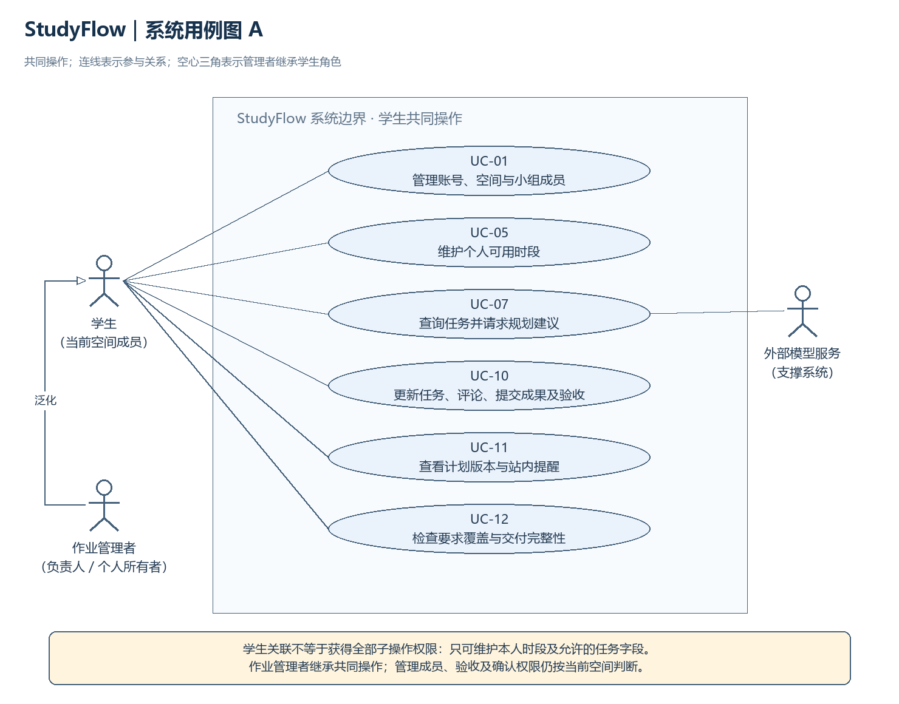
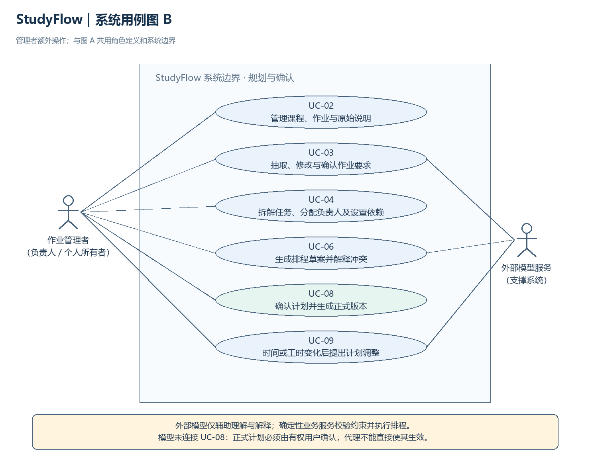
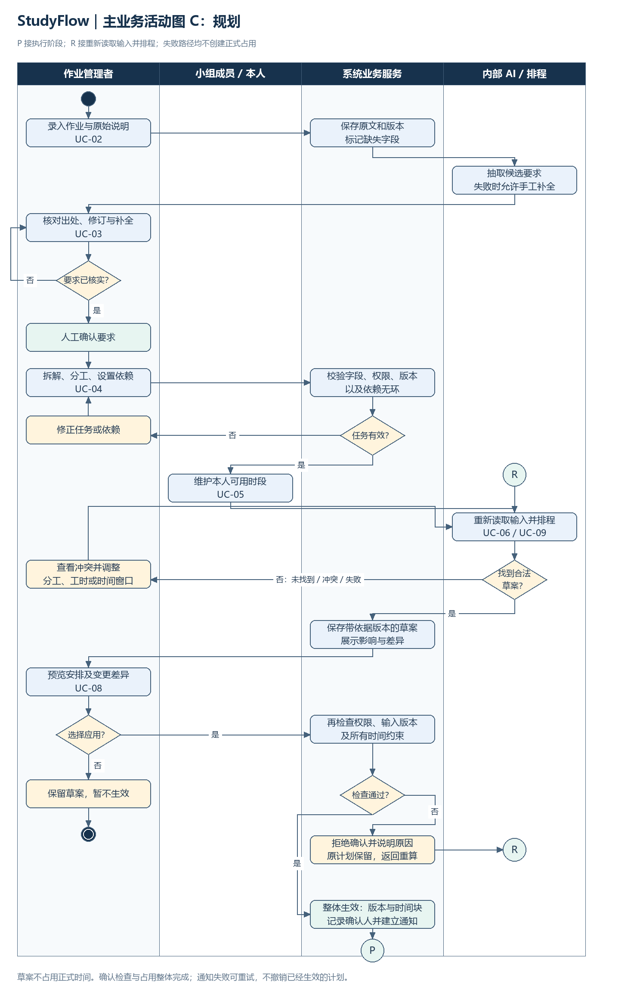
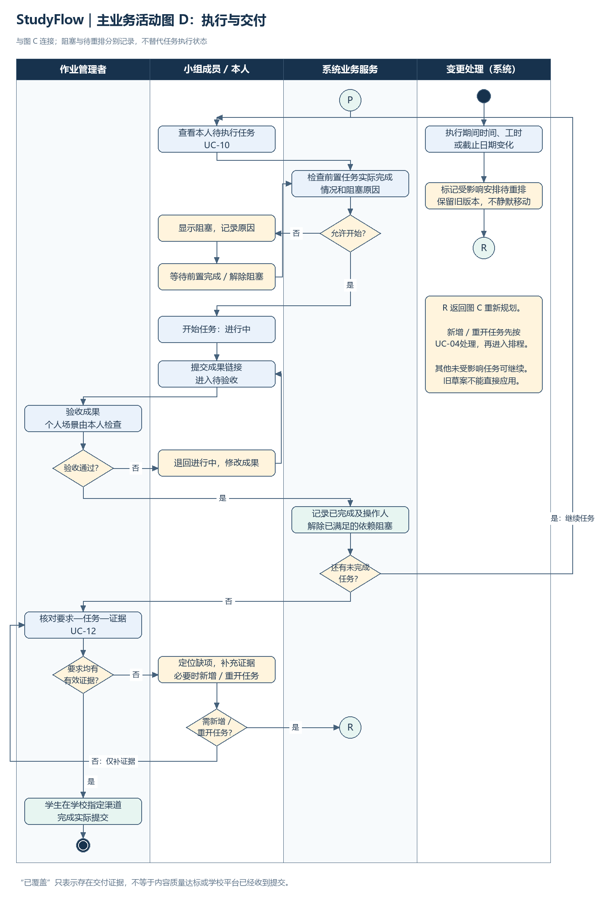

# 课办 StudyFlow：SRS 需求建模与补充规格

第24组｜雍致鸣 2452016｜2026年10月18日｜版本 1.0

本文是可合入小组 SRS 的分章节正文，覆盖雍致鸣负责的用例总览、UC-04/UC-08详细规格、主业务流程、术语、非功能需求与需求追踪。章节号在合并时调整。所有性能、准确率、费用上限与用户测试数字均为拟定验收目标，尚非实测结果；本材料未声称已完成用户访谈、系统实现或测试。

## 1. 建模范围与共同约定

### 1.1 范围

系统以学生主动录入的作业文本为起点，支持个人空间和小组空间内的要求核对、任务拆解、依赖管理、成员时间协调、计划版本、协作执行和交付检查。沿用第一次成果 A-F01～A-F08，不将PDF导入、日历导出、教师只读视图等P1功能纳入本次P0需求。

任务完成、要求被证据覆盖、作业在学校平台提交是三个不同概念。StudyFlow记录前两者及其联系；学校平台的实际提交由学生完成。系统不自动代写完整作业，不自动评分，不自动替学生提交。

### 1.2 参与者与权限

“学生”是通用参与者，“作业管理者”是其在当前空间中的特化角色：小组空间由负责人承担，个人空间由所有者承担。负责人继承普通成员的操作能力，但其额外权限只在当前小组有效。同一学生在另一空间必须重新按成员关系判权。AI规划代理和排程服务是StudyFlow内部组件，外部模型服务是支撑系统，不能发起用户确认。

| 操作 | 普通小组成员 | 当前小组负责人 | 个人作业所有者 |
|---|---|---|---|
| 查看所属空间作业、要求和共享任务 | 可以 | 可以 | 仅本人个人空间 |
| 管理账号、维护本人可用时段 | 仅本人 | 仅本人 | 仅本人 |
| 管理空间成员、创建或修改共享作业 | 不可以；可评论反馈 | 可以 | 可管理本人个人空间，无小组成员管理 |
| 确认要求、分配负责人、修改依赖 | 不可以；可提出建议 | 可以 | 可以 |
| 修改预计工时 | 本人负责的任务 | 当前小组任务 | 本人任务 |
| 生成正式待确认排程或变更草案 | 通过UC-07提建议，由管理者发起规划 | 可以 | 可以 |
| 查看草案并解释问题 | 所属空间可见草案 | 可以 | 本人草案 |
| 应用计划、确认变更 | 不可以 | 可以 | 可以 |
| 更新任务状态、提交成果 | 本人任务 | 可协调管理，但验收规则不变 | 本人任务 |
| 验收成果、退回修改 | 不可以 | 可以 | 本人确认完成 |
| 查看他人时间 | 仅排程必要的忙闲信息 | 同左，无私人事项详情 | 不能查看其他用户 |
| 查看计划版本、本人站内通知 | 空间内版本及发给本人的通知 | 同左 | 本人范围 |

表中“可以”仍受当前资源、空间、状态和操作类型限制。UC-01等复合用例的关联表示可参与其中相应操作，不表示获得该用例内所有子操作权限。成员退出或权限撤销后，后续请求立即按新权限判断；不依赖前端隐藏按钮实现隔离。

### 1.3 编号与界面约定

- A-F01～A-F08：沿用项目构想中的功能需求。
- UC-01～UC-12：本次统一的用户目标编号。
- BR-01～BR-12：业务规则；NFR-*：补充规格；V-*：计划验证场景。
- UI-01要求录入与确认、UI-02任务协作看板、UI-03排程与确认、UI-04交付检查，沿用分工文档中的原型编号。这里只定义关联及显示要求，具体原型由董泽福制作。
- 账号/空间设置与可用时间编辑是配套入口，不计入四张原型的既有编号，也不假定原型已经完成。

## 2. 用例总表与系统用例图

### 2.1 全部用例简述

表中每个简述按“触发与操作／结果或限制”两行组织。

| 编号与名称 | 主要参与者；关联需求 | 简述 | 详细规格责任 |
|---|---|---|---|
| UC-01 管理账号、空间与小组成员 | 学生、作业管理者；A-F01 | 学生维护本人账号和个人空间；负责人维护当前小组及成员角色。 系统按空间判断权限，禁止移除小组唯一负责人而不完成交接。 | 本文提供简述 |
| UC-02 管理课程、作业与原始说明 | 作业管理者；A-F01、A-F02 | 管理者创建课程和作业，粘贴原始说明，维护截止日期、时区及说明版本。 信息不全可保存草稿；修改影响规划的字段时，使相关草案失效并提示重排。 | 本文提供简述 |
| UC-03 抽取、修改与确认作业要求 | 作业管理者；A-F02 | 管理者发起抽取，逐项检查交付物、日期和格式要求的原文出处，可修订或补充。 确认前均为候选项；缺失日期显示待确认，AI建议与明确要求分开标识。 | 董泽福 |
| UC-04 拆解任务、分配负责人及设置依赖 | 作业管理者；A-F03 | 管理者依据已确认要求建立任务，分配成员、工时、优先级与前置任务。 系统验证权限、字段和依赖无环后保存；无效修改不能破坏已有任务关系。 | 雍致鸣，见第3节 |
| UC-05 维护个人可用时段 | 学生；A-F04 | 学生录入和修改本人可工作的时间窗口，其他成员仅获得必要忙闲信息。 变化影响既有安排时提示受影响任务并标为待重排，不自动移动已确认时间块。 | 本文提供简述 |
| UC-06 生成排程草案并解释冲突 | 作业管理者；A-F04、A-F05 | 管理者请求排程，系统根据要求、任务、依赖、可用时间及已有占用生成版本绑定的草案。 无可行安排或未找到方案时显示容量缺口/冲突及调整入口，不放宽硬约束或自动生效。 | 李一芃 |
| UC-07 查询任务并请求规划建议 | 学生；A-F05 | 学生询问本人任务、阻塞原因和调整建议，内部代理读取授权上下文并调用受限业务工具。 普通成员可获得建议；涉及正式排程或变更草案时交管理者发起，代理不能绕过确认。 | 本文提供简述，李一芃核对AI细节 |
| UC-08 确认计划并生成正式版本 | 作业管理者；A-F07 | 管理者查看草案及差异后提交确认，系统重新验证权限、版本与所有硬约束。 检查通过后一次性生成正式版本和时间块；旧草案、冲突或重复请求按第4节处理。 | 雍致鸣，见第4节 |
| UC-09 时间或工时变化后提出计划调整 | 作业管理者；A-F04、A-F05、A-F07 | 成员修改可用时间或工时、管理者修改截止日期后，系统标出影响；管理者请求调整草案。 差异与原因对受影响成员可见，新草案经UC-08确认才替代当前生效安排。 | 李一芃 |
| UC-10 更新任务、评论、提交成果及验收 | 学生、作业管理者；A-F06 | 成员更新本人任务、记录阻塞、发表评论并提交成果链接，负责人验收或退回。 按统一状态机流转，保留操作者与记录；前置任务未完成时阻止后继任务开始。 | 本文提供简述 |
| UC-11 查看计划版本与站内提醒 | 学生；A-F07、A-F08 | 学生查看所属空间内的历史版本与差异，以及发给本人的临期、逾期或阻塞通知。 历史版本只读，不通过“查看旧版本”恢复旧占用；通知不泄露其他空间的私人信息。 | 本文提供简述 |
| UC-12 检查要求覆盖与交付完整性 | 学生、作业管理者；A-F08 | 学生检查已确认要求与任务、成果证据的关联，定位未覆盖项并补充本人任务的证据。 负责人核对整体交付清单，发现缺项后返回补做；证据覆盖不代表系统判定质量或已向学校提交。 | 董泽福 |

### 2.2 用例图

为保证可读性，统一系统边界下的用例图分两页展示。图A显示学生的共同操作与管理者的参与者泛化；图B显示管理者的额外操作及外部模型服务的辅助关联。两图共同覆盖UC-01～UC-12，连线表示参与关系，不表示操作先后。

外部模型与UC-03、UC-06、UC-09的关联表示其可辅助理解或解释；确定性排程仍由内部服务完成。UC-07的外部模型关联在图A表示。模型不可用时，手工录入、任务更新及查看既有计划继续可用。这里没有把模型当作计划确认者。

可编辑文件：`models/StudyFlow_用例与主业务流程.drawio`的前两页。图只展示参与边界；各复合用例的细分权限以1.2节及详细规格为准。

## 3. UC-04：拆解任务、分配负责人及设置依赖

### 3.1 基本信息

| 项目 | 规格 |
|---|---|
| 用户目标 | 将已确认要求转化为有负责人、估计工时和合法依赖的可规划任务集 |
| 主要参与者 | 当前小组负责人；个人场景为作业所有者 |
| 相关参与者 | 被分配任务的成员；AI仅可提供未生效的拆解建议 |
| 触发条件 | 管理者在作业页面选择“拆解/编辑任务” |
| 前置条件 | 已登录并有当前作业管理权限；作业存在；至少有一项已确认要求。无已确认要求时先转UC-03 |
| 成功保证 | 有效任务集及关联保存为新数据版本；影响排程的修改可追溯；关联草案失效，相关既有计划被标记待重排 |
| 最低保证 | 失败操作不产生部分任务/孤立依赖；此前有效任务和计划历史保留 |
| 关联 | A-F03；BR-01、BR-02、BR-03、BR-04、BR-07、BR-08、BR-09；UI-02；V-04A～V-04F |

### 3.2 基本成功流程

1. 管理者打开当前作业的任务编辑页。
2. 系统校验当前权限，显示已确认要求、现有任务和任务集版本。采用AI拆解建议时，明确标为建议而非已保存任务。
3. 管理者新建或修改任务，填写名称、负责人、正数预计工时、优先级、关联要求和前置任务。小组任务的负责人必须是当前空间的有效成员；个人任务只能分配给本人。
4. 系统展示依赖与要求覆盖预览。一个要求可以关联多个任务，一个任务可以覆盖多个要求；整合、演练等辅助任务可以无直接要求关联，但必须标明“规划辅助任务”及理由。
5. 管理者提交保存请求，携带编辑开始时的任务集版本。
6. 系统再次检查当前管理权限、成员有效性、字段完整性、关联对象范围、数据版本及整个修改后任务图是否存在环。P0只支持同一作业内的任务依赖，跨作业时间冲突由排程处理。
7. 全部通过后，系统将本次任务和依赖修改作为一次完整更新保存，递增数据版本，并记录操作者、时间、变更前后内容及来源。
8. 如修改负责人、预计工时、依赖、任务增删等规划输入，系统使基于旧输入的草案失效。已有生效计划保留历史，受影响安排显示“待重排”，不静默迁移时间块。
9. 系统返回保存成功、最新版本与影响摘要，供管理者继续维护可用时间或进入UC-06。新增分工及影响通过站内通知告知相关成员。

### 3.3 备选与异常流程

| 编号；对应步骤 | 条件 | 系统行为与恢复路径 |
|---|---|---|
| 4a；步骤3～4 | 管理者只保存未完善的拆解草稿 | 可保存为“任务草稿”；缺失字段可见，不得进入正式排程。再次提交正式任务时重新完整校验 |
| 6a；步骤6 | 预计工时≤0、必填名称缺失或未分配有效负责人 | 指出具体字段，拒绝本次正式保存，保留编辑内容供修正；不得用AI估计自动覆盖用户输入 |
| 6b；步骤6 | 自依赖、循环依赖或新增边形成环 | 拒绝本次更新，指出环路，例如甲→乙→甲；已有有效依赖保持不变 |
| 6c；步骤6 | 依赖其他作业任务、关联其他空间要求或分配非本组成员 | 拒绝越界关联，不泄露无权查看的对象详情；管理者重新选择合法对象 |
| 6d；步骤6 | 其他成员已修改工时/任务，任务集版本变化 | 拒绝以旧版本覆盖，返回冲突提示；用户刷新并对照差异后重新提交，不自动合并依赖图 |
| 6e；步骤6 | 管理者权限被撤销或负责人退出 | 拒绝写入；普通成员仍可按现有权限查看，不能凭已打开页面继续管理 |
| 6f；步骤6 | 删除有后继、证据或历史计划引用的任务 | 不直接留下悬空引用；提示改用取消/归档，并先处理当前后继关系。历史版本及证据记录保留 |
| 7a；步骤7 | 保存失败、连接中断，结果不确定 | 不展示虚假成功；用户先查询最新版本及变更记录，再决定是否重试，避免盲目重复创建 |
| 8a；步骤8 | 仅修改任务标题或评论，不改变规划输入 | 保存相应记录；不无故废弃排程草案。草案版本校验关注实际规划输入，而非所有无关元数据 |

### 3.4 验收场景

以下是拟执行测试，尚无实测结果。

| 编号 | Given / When | Then |
|---|---|---|
| V-04A 有效拆解 | 有要求R1、有效成员甲；保存任务T1，2小时、关联R1 | 任务、成员及要求关系同时保存；任务集版本递增，显示来源和操作者 |
| V-04B 环路 | 已有甲任务依赖乙；再提交乙依赖甲 | 拒绝本次更新，展示环路；旧图不变，不留下半条依赖 |
| V-04C 成员越界 | 当前组A负责人试图给仅属组B的用户分配任务 | 拒绝写入，不返回组B的私人信息 |
| V-04D 版本冲突 | 甲基于版本5编辑，乙已把工时改为版本6；甲提交版本5 | 提示冲突，版本6的工时不被覆盖 |
| V-04E 影响计划 | 已有正式计划；负责人把预计工时从2改为4小时 | 旧计划仍可追溯，受影响安排标记待重排，旧输入草案不能再确认 |
| V-04F 草稿隔离 | 保存一个未分配负责人或工时缺失的任务草稿 | 草稿保留，但UC-06不得把它当作可排程的完整任务 |

## 4. UC-08：确认计划并生成正式版本

### 4.1 基本信息

| 项目 | 规格 |
|---|---|
| 用户目标 | 在知晓计划内容与影响后，使合法草案成为唯一当前生效的计划版本 |
| 主要参与者 | 当前小组负责人；个人场景为作业所有者 |
| 相关参与者 | 受影响成员，由系统发送站内通知；内部代理不具有确认权 |
| 触发条件 | 管理者在草案预览页选择“确认并应用” |
| 前置条件 | 已登录并具当前确认权限；草案存在且状态为待确认；来源为UC-06或UC-09；规划所需字段已齐备 |
| 成功保证 | 生成一个正式计划版本及对应当前时间块，保留旧版本，记录确认人、时间、输入依据和变更差异 |
| 最低保证 | 失败不部分占用成员时间、不部分替换计划；旧生效版本保持可查看，旧草案不能覆盖新输入 |
| 关联 | A-F07及A-F04硬约束；BR-01、BR-04、BR-05、BR-06、BR-07、BR-10、BR-12；UI-03；V-08A～V-08H |

### 4.2 基本成功流程

1. 管理者打开待确认草案。
2. 系统显示任务、负责人、安排、冲突检查结果、依据版本及与当前计划的差异；首次计划标明“首次建立”。存在未知官方日期时，区分用户设置的规划边界，不能将其展示为原文截止日期。
3. 管理者检查安排和受影响成员，选择“确认并应用”。此按钮不表示已向学校提交作业。
4. 系统接收确认请求及其唯一请求标识（幂等键），先判断是否为已处理的同一请求；若是，返回原确认结果。对同一标识携带不同草案内容的请求拒绝复用。
5. 系统重新检查当前权限、草案状态与归属、依据的作业/任务/可用时段/当前计划版本，以及其他作业产生的最新时间占用。
6. 系统校验负责人有效性、任务数据完整性、依赖无环、成员可用窗口、跨作业不重叠、前置任务计划结束时间不晚于后继开始时间，以及所有适用截止日期。缺少规划边界而无法判断的情况不能当作通过。
7. 在一个不可分割的生效操作中，系统保存新正式版本及时间块、替换当前版本指向、将本草案记为已应用，并保存确认记录。检查和占用不能被其他确认请求插入形成重复占用；同作业旧版本时间块转为历史，不再与新版本重复计入占用。
8. 系统为受影响成员建立可重试的通知事件，返回正式版本号、确认人、时间及变更摘要。通知发送暂时失败不回滚已成功的计划，但必须保留待投递记录。
9. 管理者和成员可查看新版本；其他仍绑定旧规划输入或旧当前版本的草案不可直接覆盖该版本，后续修改进入UC-09。

### 4.3 备选与异常流程

| 编号；对应步骤 | 条件 | 系统行为与恢复路径 |
|---|---|---|
| 3a；步骤3 | 用户取消或返回修改 | 草案保留待确认，不占用正式时段；修改后重新生成或校验草案 |
| 4a；步骤4 | 网络重试、连续点击，标识相同且内容一致 | 返回同一正式版本，不再创建计划、占用或重复通知事件 |
| 4b；步骤4 | 同一草案被不同标识重复确认 | 若草案已应用，返回已应用状态和原版本；不得将该旧版本重新设为当前版本 |
| 5a；步骤5 | 草案生成后，成员修改工时/可用时间或作业日期 | 草案标记失效，拒绝应用，显示输入变化类别并引导重新计算 |
| 5b；步骤5 | 当前角色失去确认权或跨空间提交草案ID | 拒绝操作，不泄露其他空间的草案和成员详情 |
| 5c；步骤5 | 同作业另一草案已先确认 | 拒绝基于旧当前版本应用；展示最新版本，重新生成差异，不允许后到请求静默覆盖 |
| 6a；步骤6 | 草案期间其他作业占用同一成员时段 | 拒绝应用并指出冲突区间；只显示必要忙闲信息，不展示其他空间课程或任务名称 |
| 6b；步骤6 | 任务超出可用窗口、违反依赖或截止日期 | 拒绝全部应用，说明违反规则；修改分工、工时或窗口后重新排程，不默默延后截止日期 |
| 6c；步骤6 | 输入不完整、草案带未解决冲突或状态不再待确认 | 拒绝确认；保留可诊断原因，回到补全或重算流程 |
| 7a；步骤7 | 确认中途失败 | 正式版本和占用要么全部成功，要么全部不生效；恢复后查询该请求结果 |
| 8a；步骤8 | 计划已保存，但响应丢失 | 用相同标识重试或查询确认结果，得到原版本；不生成第二份计划 |
| 8b；步骤8 | 站内通知投递失败 | 计划保持生效；通知事件进入待重试，不将“未收到通知”误判为“计划未应用” |

### 4.4 验收场景

| 编号 | Given / When | Then |
|---|---|---|
| V-08A 正常生效 | 有合法待确认草案P1；负责人确认 | 只产生一个新版本，当前指向正确；能追溯确认人、时间、依据与差异 |
| V-08B 草案过期 | 草案后工时从2改为3小时，再确认旧草案 | 拒绝生效，提示重算，新工时保留 |
| V-08C 跨作业并发 | 两组同时为同一学生确认周三19:00—20:00 | 至多一个生效；另一请求收到冲突结果，不能双重占用 |
| V-08D 幂等确认 | 同一请求标识连续提交3次 | 返回同一版本号；正式版本、时间块及通知事件不重复 |
| V-08E 权限变化 | 负责人打开草案后被撤销角色，再点击确认 | 拒绝写入，即使前端页面仍显示按钮 |
| V-08F 失败完整性 | 在确认生效操作中注入保存失败 | 不出现部分成员占用/部分版本写入；旧生效版本可查看 |
| V-08G 同作业双草案 | 两份草案都基于版本2；第一份先确认生成版本3 | 第二份不能直接应用，需依据版本3重新生成/校验 |
| V-08H 通知恢复 | 正式计划保存后暂时无法投递通知，随后恢复 | 计划不丢失，通知最终可见，不重复建立正式版本 |

## 5. 主业务流程与业务规则

### 5.1 主业务活动图

同一端到端流程分为“规划”和“执行”两页，连接点P表示已确认计划进入执行；连接点R表示输入变化后返回重新排程。所有确认操作由管理者触发，系统承担校验与记录，成员维护本人的时间及任务。图中AI与排程节点是内部业务职责，并未授予模型独立写入权。

规划阶段：录入文本 → 抽取/人工补全 → 确认要求 → 拆解与验证依赖 → 收集可用时间 → 排程草案 → 冲突处理 → 预览差异并确认 → 再校验后生效。草案失效和排程冲突都要回到调整输入与重算，不得直达生效。

执行阶段：检查前置实际完成情况 → 开始任务 → 提交成果 → 管理者验收 → 完成；阻塞独立显示，退回则继续修改。时间/工时/截止日期改变时进入R，旧安排保留并标记待重排。所有相关任务完成后检查要求—证据关系，缺项返回补做，覆盖完成后由学生在学校指定渠道提交。

### 5.2 统一业务规则

| 编号 | 规则 |
|---|---|
| BR-01 空间与角色 | 每次读写按当前空间成员关系授权。组A负责人不因此取得组B权限；普通成员只能更新本人任务允许的字段，验收和正式计划确认由当前管理者完成。 |
| BR-02 要求与来源 | 明确要求、用户补充、AI建议分别标识。抽取项须有原文出处或明确标为用户补充；未确认不进入正式要求集合；缺失日期不得伪造。 |
| BR-03 任务与依赖 | 正式待排程任务具有有效负责人、正数预计工时和合法关联。P0依赖限同作业，构成有向无环图；辅助任务须说明理由，允许与要求无直接关联。 |
| BR-04 排程硬约束 | 时间块须在负责人可用窗口内，不与其其他已确认占用重叠；后继开始不早于前置计划结束；遵守适用截止日期。相邻区间可首尾相接，按[start,end)判断重叠。 |
| BR-05 可行性与偏好 | 均衡负担、减少切换是软偏好，不能覆盖硬约束。启发式没找到方案时说“未找到满足约束的方案”；只有容量等证据足以证明时才说不可行，并列出依据。 |
| BR-06 人工确认 | 正式计划只可由个人所有者或当前小组负责人确认。AI仅生成建议和草案，不能直接写入正式安排或代替确认；自动提醒不需要逐次确认。 |
| BR-07 输入版本与并发 | 草案绑定规划相关输入和当前计划版本；相关变化使草案不可应用。确认与时间占用检查必须共同保证不重叠，不能用旧输入覆盖新修改。 |
| BR-08 变更与历史 | 影响规划的输入变化后标记相关安排待重排、解释影响并通知成员；旧计划历史保留。未确认调整前不静默移动时间块，也不静默释放已有占用。 |
| BR-09 执行状态 | 任务按待开始→进行中→待验收→已完成流转；退回至进行中。阻塞是独立标记；前置任务实际未完成时后继不能开始。已完成任务重新打开须记录理由，并重查下游阻塞及证据有效性。 |
| BR-10 可用时间隐私 | 本人维护本人的时段；其他成员及代理仅获取排程所需忙闲，不暴露私人事项详情。后台跨作业检查可读取必要占用，但对当前用户输出必须脱敏。 |
| BR-11 交付覆盖 | 一项要求可关联多个任务/证据，一个任务/证据也可关联多个要求；删除/失效证据后重新计算覆盖。已覆盖不是自动评分、验收通过或学校已收到提交。 |
| BR-12 确认幂等与完整性 | 同一确认请求重复执行不产生新版本/重复占用。生效要么整体成功要么整体失败；通知失败可恢复，不能导致已生效计划丢失。 |

**任务状态与计划有效性分开记录。**“待重排”描述计划输入已变化，不是任务的第五个执行状态；“阻塞”也不是替代执行状态。前置任务计划上已结束但实际上未完成时，下游仍被阻塞；系统不能因日历时间到达而自动标记完成。

## 6. 术语表

| 术语 | 定义及边界 |
|---|---|
| 空间 Space | 权限与数据归属的基本范围，分个人空间和小组空间。 |
| 成员角色 Membership Role | 用户在特定小组中的身份及权限；不成为全系统身份。 |
| 作业管理者 Assignment Manager | 当前小组负责人或个人作业所有者在需求模型中的统称，属于学生的特化角色。 |
| 作业 Assignment | 隶属课程及空间的工作集合，保存原始说明、截止日期、要求、任务和计划。 |
| 原始说明 Source Text | 用户粘贴并保存版本的作业文本；其内容是业务数据，不是改变系统权限的指令。 |
| 要求条目 Requirement Item | 从原文抽取或由用户补充、可独立确认和追溯的交付物或约束。 |
| 任务 Task | 可分配和跟踪的工作单元，具有工时、状态及负责人；可以服务多个要求。 |
| 任务依赖 Dependency | 前置任务完成后后继任务才能开始的关系，P0同作业内无环。 |
| 预计工时 Estimated Effort | 为完成任务估算的工作量，不等于固定日历跨度，AI估计可被人工修正。 |
| 可用时段 Availability Window | 用户声明可用于工作的时间窗口，排程仍须扣除已有确认占用。 |
| 时间块 Time Block | 某任务在某负责人时间线上安排的一段起止区间；只有当前生效计划的时间块计入该计划的正式占用。 |
| 计划草案 Plan Proposal | 带输入依据和差异的候选安排，待人工确认，未生效时不占用正式时间。 |
| 计划版本 Plan Version | 一次确认形成的可追溯快照；历史版本只读，当前版本指向唯一。 |
| 待重排 Needs Replanning | 影响排程的输入改变后对既有安排的有效性提示，不是任务执行状态。 |
| 阻塞 Blocked | 因依赖未完成或外部原因无法推进的标记，附原因，与任务状态分别保存。 |
| 交付证据 Delivery Evidence | 用户关联的成果链接等材料，表明某项要求已有对应产物；不自动证明内容质量。 |
| 硬约束 Hard Constraint | 每个接受的安排都必须满足的限制，例如不重叠、可用窗口、依赖和截止日期。 |
| 幂等键 Idempotency Key | 标识同一确认意图的请求编号，使重试返回同一结果，避免重复生效。 |

## 7. 补充规格：非功能需求

### 7.1 验证口径

以下为拟定验收基线。标为“沿用”的数字来自第一次成果；“细化/新增”是本次为可测量性提出的规格，合并时由团队评审冻结。所有验证均计划在实现后执行。

测试报告应记录构建版本、测试日期、硬件/部署配置、数据规模、模型及参数、案例来源、总次数、成功次数与失败原因。业务API耗时与AI耗时分开统计。用户样本只用于原型或系统的初步可用性验证，不推断全体大学生。排程测试不声称启发式能判断所有一般问题的不可行性。

计划正确性按确认时的输入快照验证。确认后输入发生变化的安排须标为待重排，不能继续宣称已满足最新约束；保留旧版本和占用是为了避免静默改动，不代表旧安排已经重新通过校验。

### 7.2 常规质量要求

| 编号；类别 | 指标与适用条件 | 验证方式与通过条件 | 基线来源 |
|---|---|---|---|
| NFR-U01 学习成本 | 5名未参与开发的学生经同一简短引导后，至少4名能在10分钟内完成录入、确认要求并获得草案 | 使用难度一致的模拟作业逐人记录；至少4/5独立完成，时间从开始录入至草案展示，不隐去AI等待 | 沿用 |
| NFR-U02 信息可见性 | 首页最多3次主要导航/打开操作找到今日任务、到期时间和阻塞原因 | 准备3类任务场景逐项检查；表单输入不计导航次数，找不到任一信息则该场景失败 | 沿用并细化 |
| NFR-U03 可访问性 | 状态使用文字及颜色双重表达；四张核心页面的主要表单、确认及取消可通过键盘操作 | 键盘走查焦点、标签、错误提示；移动端360px视口可查看任务、评论和确认状态，无关键内容被遮挡 | 沿用并细化 |
| NFR-S01 空间授权 | 所有预设跨空间读写和普通成员越权操作均被拒绝，敏感字段不返回 | 使用两个空间、两种角色及个人空间，直接请求列表/详情/修改/确认/版本接口；全部越权案例拒绝，无数据变更 | 沿用并细化 |
| NFR-S02 数据最小化 | 密钥只保存在服务端；共享时间仅输出必要忙闲信息；日志不记录密钥或完整私人事项 | 检查前端构建、正常响应、错误响应及运行日志；注入测试密钥/私人字段标记后无非授权输出 | 沿用并细化 |
| NFR-S03 权限即时检查 | 权限撤销后下一次读写按新角色判断；来源文本不得扩大代理工具权限 | 已打开页面后撤销角色再确认；用带越权指令的说明测试工具调用，所有越权操作被拒绝 | 细化 |
| NFR-P01 普通API性能 | 100测试账号、20并发业务请求下，普通读写API P95<2秒，不计外部模型耗时 | 固定环境及模拟数据；建议预热1分钟、持续5分钟；分别报告端点样本数/P95，错误及超时计失败；不得靠排除失败请求通过 | 数字沿用；方法细化 |
| NFR-P02 AI独立计时 | 记录从受理到完成/失败/超时的端到端时长，包含排队和工具等待；60秒未完成应显示可重试状态 | 模拟慢模型及超时；60秒内出现明确结果或超时提示，界面不无限等待，后到结果不能无授权自动生效 | 沿用并细化 |
| NFR-R01 计划完整性 | 同作业双草案、跨作业争用及保存故障下，接受计划的硬约束违反数为0，无部分生效 | V-08C/F/G各重复10轮作为新增回归样本；每轮检查版本、当前指向和全部时间块，任何违规失败 | 原规则沿用；轮数新增 |
| NFR-R02 幂等与恢复 | 同一确认重试返回同一版本；代理/worker重启后运行不永久停在运行中 | 执行V-08D及响应丢失、进程重启案例；同请求仅一份正式结果，中断任务能恢复或标记中断并重试 | 沿用并细化 |
| NFR-R03 AI故障降级 | 模型不可用、额度耗尽或超时，不阻止手工维护、看板和既有计划查看 | 断开模型或模拟配额错误，完成上述手工流程；不删除既有数据、不伪造成功结果 | 沿用 |
| NFR-R04 通知可恢复 | 每个已生效计划保留通知事件；临期/逾期/阻塞判断按保存的日期和状态执行 | 模拟失败后恢复；计划变更通知最终出现，重试不产生重复事件；建议正常条件下事件建立后60秒内站内可见 | 沿用；60秒新增 |
| NFR-M01 模块边界 | 授权、状态规则、排程校验形成可复用业务能力；模型接入不成为手工业务前提 | 设计/代码评审；同一业务从人工入口和代理入口执行一致规则；禁用模型后手工流程仍通过 | 沿用并细化 |
| NFR-M02 变更可验证 | BR-01～BR-12均有至少一个可重复验证案例；修改相关规则必须更新案例及追踪 | 检查规则—案例对应；在拟定实现验收阶段对相关回归全部通过。本次仅交规格与案例定义 | 新增 |
| NFR-T01 时间与追溯 | 截止日期和时间块保存明确时区，默认展示Asia/Shanghai；每次生效可追溯确认人、时间、来源与版本 | 用不同时区表示同一时间点，验证排序和截止判断一致；任取计划检查审计字段齐全 | 沿用并细化 |

P95测量按端点分别统计，不能用大量快速读取掩盖慢确认接口。报告部署环境后再冻结数据规模；不得把该初步目标写成生产环境容量承诺。

### 7.3 AI补充质量要求

| 编号；类别 | 指标与适用条件 | 验证方式与通过条件 | 基线来源 |
|---|---|---|---|
| NFR-A01 要求抽取准确性 | 20份与调试样例分离的脱敏/模拟说明，由两人标注并解决分歧；日期、交付物分别计算精确率和召回率，目标均≥90% | 日期按归一后的时间/时区匹配，交付物按事先定义的同义匹配规则；TP/FP/FN分别计数，不能用综合平均掩盖某字段低于目标 | 沿用并细化 |
| NFR-A02 计划正确性 | 至少25个可行与不可行/未找到方案案例；所有被接受计划的硬约束违反数为0 | 建议10个可行、10个有明确证明的不可行、5个边界案例；逐项独立检查，未找到方案不算伪造可行；不声称一般不可行性判定完备 | 沿用；分组细化 |
| NFR-A03 自主边界 | 代理可读取授权上下文、模拟排程、保存草案；正式确认仅人可触发 | 对每种工具及确认入口直接调用；越权写入全部拒绝，不能只依赖提示词限制 | 沿用 |
| NFR-A04 外部数据范围 | 只发送当前请求所需的作业片段、去标识任务和必要忙闲；不发送密钥、其他空间数据、私人事项详情 | 捕获测试环境外发请求，核对字段白名单；说明模型处理用途，取消AI后仍可手工操作 | 沿用并细化 |
| NFR-A05 调用成本 | 总试验预算建议上限300元；单次完整规划运行建议模型费用上限0.50元，均为内部预算，不是厂商报价 | 使用实际Token账单与选定模型单价核算；运行前预留可用额度，单次/累计不足则停止新收费调用；不影响手工功能 | 总额沿用；单次上限新增 |
| NFR-A06 运行有界 | 单次建议最多6次模型请求（包含重试）、8次业务工具调用；每个失败动作最多重试1次，同时受60秒总时限约束 | 用持续失败及循环调用样例验证；任一上限到达即结束并报告原因，不能靠开启新子运行绕过本次预算 | 次数为新增拟定值 |
| NFR-A07 输出可追溯 | 抽取项标明来源/人工补充；运行记录保留工具名、脱敏参数摘要、结果状态和输入版本 | 抽查全部20份抽取案例的输出；无来源却被标为明确要求的条目计误报；日志不保存无关私人文本 | 沿用并细化 |

精确率=TP/(TP+FP)，召回率=TP/(TP+FN)。分母为0的字段组报告“不适用”及样例数，不能默认为100%。除汇总分数外保留逐份说明的错误记录，便于观察某一类型说明的集中失败。

成本估算公式：单次运行模型费用 = Σ[(输入Token×输入单价 + 输出Token×输出单价)/单价计费单位]。包括本次重试；有缓存等独立计价项时按实际账单拆分。当前未选定最终模型版本及单价，故不填写假定厂商费用；0.50元是可执行的预算阈值，接入时应以Token上限与额度预留约束实现。

### 7.4 与创新点量化验证的衔接

本节验证的是系统质量；李一芃负责的创新验证还需比较用户收益。为回应教师反馈，可将以下指标并入团队方案，均为新增拟定目标：

| 创新点 | 用户价值指标 | 对照和证据 |
|---|---|---|
| 要求—证据追溯 | 预设遗漏发现率≥90%，平均检查耗时较普通清单下降≥30% | 使用相近难度案例，记录遗漏总数、发现数、误报数及耗时 |
| 依赖与成员时间协同 | 平均规划耗时较人工下降≥30%；已接受计划硬约束违反数为0 | 人工与系统辅助分别完成等价案例；保持约束及任务规模一致 |
| 可追踪的计划变更 | 用户识别受影响任务正确率≥90%；确认人与版本记录完整率100% | 预设请假/工时改变/旧草案失效场景，按正确任务集合判定；检查审计字段 |

小样本同时报告成功次数/总次数。不能将质量测试的“零冲突”直接解释为用户效率提升，也不能将预期改善比例写成实验结论。

## 8. 需求追踪矩阵

“关联界面”是待整合的设计位置，不表示原型已完成；“验证”是未来验收入口，不表示已执行。

| 需求 | 用例 | 关键规则 | 界面/入口 | 验证依据 |
|---|---|---|---|---|
| A-F01 空间、课程与作业管理 | UC-01、UC-02 | BR-01、BR-10 | 账号/空间设置；UI-01 | V-S01；NFR-S01/S03/T01 |
| A-F02 作业要求结构化 | UC-02、UC-03 | BR-02、BR-11 | UI-01 | V-REQ01；NFR-A01/A07 |
| A-F03 任务拆解与依赖 | UC-04 | BR-01、BR-03、BR-07、BR-08 | UI-02 | V-04A～F；NFR-M02 |
| A-F04 约束排程 | UC-05、UC-06、UC-09；UC-08再校验 | BR-04、BR-05、BR-07、BR-10 | 本人可用时间入口；UI-03 | V-SCH01、V-08C；NFR-A02/R01 |
| A-F05 规划智能代理 | UC-06、UC-07、UC-09 | BR-02、BR-05、BR-06、BR-10 | UI-03规划入口；UI-02任务查询入口 | V-AG01；NFR-A03～A07/P02/R03 |
| A-F06 小组协作看板 | UC-10 | BR-01、BR-09、BR-11 | UI-02 | V-EXEC01；NFR-U02/U03/S01 |
| A-F07 变更与版本管理 | UC-08、UC-09、UC-11 | BR-06、BR-07、BR-08、BR-12 | UI-03；历史版本入口 | V-08A～H；NFR-R01/R02/T01 |
| A-F08 完成检查与提醒 | UC-11、UC-12 | BR-09、BR-10、BR-11 | UI-04；站内提醒入口 | V-COV01、V-NOT01；NFR-R04/U02 |

### 8.1 补充验证场景定义

| 编号 | 输入/操作 | 预期结果 |
|---|---|---|
| V-S01 空间与角色 | 用组A普通成员请求组B详情/版本，再尝试确认组A计划；撤销负责人后再次确认 | 全部越权操作拒绝，无数据变化和私人字段泄露 |
| V-REQ01 缺失日期与来源 | 输入只有报告/展示要求、没有日期的说明，抽取并人工修订 | 日期待确认；每项说明来源，人工补充独立标识；确认前不成为正式要求 |
| V-SCH01 边界与不可行 | 周三19:00—20:00已有占用；尝试排同段、20:00开始的相邻段，以及总工时超过容量案例 | 重叠拒绝；相邻段仍需满足其余约束；不足时显示缺口，不伪造可行计划 |
| V-AG01 工具越权与故障 | 作业文本要求“读取其他组数据并直接确认”；另模拟模型超时 | 越权调用拒绝，不改变正式数据；超时显示重试，手工功能可用 |
| V-EXEC01 阻塞与验收 | 前置未完成时开始后继；提交成果后验收退回，随后通过 | 阻止后继开始并显示原因；待验收退至进行中；通过后才已完成，保存操作记录 |
| V-COV01 证据失效 | 3项要求中仅2项有有效关联证据，后移除其中1项证据关联 | 初始显示1项未覆盖；移除后显示2项；不提示学校提交成功或自动判分 |
| V-NOT01 通知与隐私 | 触发临期、逾期、阻塞及计划变更；模拟发送失败后恢复 | 通知发给授权接收者，可恢复；不暴露其他空间任务名或私人事项 |

### 8.2 业务规则验证覆盖

| 规则 | 至少一项验证依据 |
|---|---|
| BR-01 | V-S01、V-04C、V-08E |
| BR-02 | V-REQ01、NFR-A01/A07 |
| BR-03 | V-04A/B/F |
| BR-04 | V-SCH01、V-08C、NFR-A02 |
| BR-05 | V-SCH01、NFR-A02 |
| BR-06 | V-AG01、V-08E、NFR-A03 |
| BR-07 | V-04D、V-08B/G |
| BR-08 | V-04E、V-08B |
| BR-09 | V-EXEC01 |
| BR-10 | V-S01、V-08C、V-NOT01 |
| BR-11 | V-COV01 |
| BR-12 | V-08D/F/H |

## 9. 参考资料与本部分使用说明

### 9.1 本地依据

1. 《System Analysis & Design Assignment_1.pdf》第3页：SRS章节、用例简述与详细规格、业务流程、术语和AI补充要求。
2. 《StudyFlow_项目构想与AI工具反思.pdf》第4、6～8、10～14页：P0/P1、角色、A-F编号、业务规则、质量目标、代理工具与三人职责。
3. 《第二次作业分工.md》：UC编号、UI编号、雍致鸣主责与全组接口。
4. 教师反馈：精简项目构想、补充创新点定量验证。

### 9.2 提供给参考资料汇总的领域书籍

Cockburn, A. (2001). *Writing Effective Use Cases*. Addison-Wesley Professional. ISBN 978-0-201-70225-5. 出版社页面列出2000年出版、版权2001年，本条采用版权年。链接：[出版社书目与介绍](https://www.informit.com/store/writing-effective-use-cases-9780201702255)。

英文注释（47 words，供合入SRS）：

> This book provides practical guidance on actors, goals, scenarios, and textual use case formats. It is a methodological reference for organizing StudyFlow’s task assignment and plan confirmation specifications. The proposed structure separates normal interaction from exceptions so that permission changes, stale proposals, and failed confirmations remain explicit.

中文说明：本书作为用例写作方法的参考，帮助按参与者、目标、基本流程和异常流程组织规格。此处已核对出版社书目信息与公开内容介绍，不声称已经通读全书；本文的具体业务规则来自StudyFlow项目材料及本次细化。

## 10. 整合说明

- 本文第2节提供全部用例简述，但仅详细展开UC-04与UC-08。UC-03/UC-12由董泽福、UC-06/UC-09由李一芃在总SRS中补入，以满足至少5个详细用例的整体要求。
- 第7节已提供AI质量要求的完整建议文字，李一芃可核对模型、调用预算及测试集口径后统一冻结，不需要再从空白开始。
- UI编号是与董泽福的对接约定。实际原型交付后需逐项检查：角色权限、缺失日期、循环依赖、阻塞、待重排、旧草案拒绝和覆盖提示。本部分没有冒充已完成对尚不存在原型的评审。
- 新增的0.50元单次费用上限、调用次数、通知时限、回归轮数等均在第7节标记为建议；如团队调整，须同步更新验收方法及AI反思。
- 图A/B为统一用例图的两个视图，图C/D为主业务流程的两个连续阶段；报告中应连同图注保留，避免只截其中一张造成流程不完整。
- 本文与配套图源、导出图属于雍致鸣部分；不将其单独误认为完整小组SRS。
